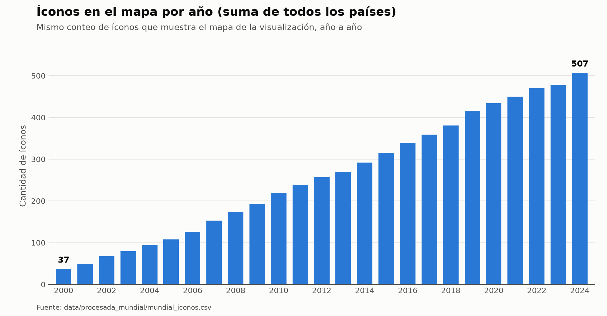

# Entrega 2 — El proceso de diseño: la visualización salta al mundo físico (IIC2026)

**Grupo 8**

> **Cómo usar esta plantilla (borrar antes de exportar):**
> - `[COMPLETAR: …]` = dato que solo ustedes tienen. `[CONFIRMAR: …]` = borrador mío que hay que validar o corregir.
> - Respetar los máximos de líneas que indica cada campo (están en el enunciado y en los títulos).
> - Lecciones de la E1: (1) anclar **cada** cambio en un principio del curso; (2) responder **todas** las críticas de cada revisión, adoptadas o descartadas; (3) no atribuirle a una revisión cambios hechos antes (usar las fechas de los commits); (4) **video en varias versiones**, no solo en la final; (5) thinking aloud real con persona externa.

## 1. Portada

**Integrantes:**

- Catalina Isabel Díaz Oyanedel
- Diego Jesús Olivares Pérez
- Joaquín Alonso Toro Parra
- Rocío Antonia Márquez Correa

**Enlaces:**

- GitHub Pages: https://dogo42005.github.io/Proyecto_Infovis/
- Repositorio: https://github.com/dogo42005/Proyecto_Infovis
- Video demostrativo (final, público): [COMPLETAR: link YouTube/Drive público]

---

## 2. Contexto general

### Propósito de la fisicalización (máx. 10 líneas)

La E1 mostraba en pantalla cómo el uso de internet se expandió por el mundo entre 2000 y 2024, pero el paso del tiempo se controlaba con un slider: un gesto abstracto, sin relación con el dato. En la E2 el tiempo se vuelve un objeto: una rueda de cartón con los años 2000–2024 dispuestos en sentido horario, que el usuario recorre con la mano. Recorrer el tiempo pasa a ser un gesto físico con mapeo natural (horario = avanzar, como un reloj), y el objeto deja a la vista todo el rango temporal a la vez, algo que el slider escondía. La sonificación sigue el mismo dato que el mapa (cacofonía de notificaciones cuyo ritmo depende de la cantidad de íconos del año), de modo que mano, oído y vista reciben la misma tendencia por tres canales: codificación redundante, que hace el mensaje legible aun sin mirar la pantalla. [CONFIRMAR: ajustar a la versión final real de la rueda táctil]

### Procesamiento de datos (máx. 8 líneas)

Se reutilizan los datos procesados de la E1 (Banco Mundial: uso de internet, población y densidad; fronteras Natural Earth) sin cambiar el dataset. Para la interacción física se discretizó el tiempo en **25 posiciones, una por año** (en la versión de brújula, 25 bandas de 14,4° con 1,5° de histéresis para que el ruido del sensor no haga saltar el año). El total de íconos crece de **37 en 2000 a 507 en 2024** y los países con al menos un ícono pasan de 15 a 137 (gráfico abajo); ese rango define el ritmo del sonido y de la vibración, que usan la misma función de intervalo que la sonificación. En la versión táctil, cada año es un punto entrenado sobre la rueda (radio de aceptación 0,045 en coordenadas normalizadas) y el toque se confirma por altura del dedo (cámara frontal) con lecturas de máximo 250 ms de antigüedad.

---

## 3. V1 — La idea completa: teléfono que rota, sin base

**Identificación**

- Fecha: 29 de octubre – 2 de noviembre de 2026 (avance en clase el 29 y 30 de octubre)
- Commits: [`a01718b`](https://github.com/dogo42005/Proyecto_Infovis/commit/a01718b) "Implementacion protobject telefono", [`b3bb295`](https://github.com/dogo42005/Proyecto_Infovis/commit/b3bb295) y [`3bd2288`](https://github.com/dogo42005/Proyecto_Infovis/commit/3bd2288) "Arreglo sensor 2" (estado final de V1, 2 de noviembre)

**Evidencia**

- Foto(s) del teléfono rotando sin base: [COMPLETAR]
- Video corto con manipulación y sonido: [COMPLETAR]

**Qué cambió (máx. 8 líneas)**

Primera versión físico-digital. El teléfono, **sin base**, se vincula a la visualización con Protobject (QR del botón +) y funciona como una perilla (artefacto 02 del Physical Viz Toolkit): al girarlo plano sobre la mesa, los 360° se dividen en 25 bandas de 14,4°, una por año, que mueven el año del mapa. El teléfono muestra una brújula con el rumbo, la inclinación y el año asignado, y un selector para elegir el país cuya cacofonía de notificaciones suena en el computador. Si `Protobject.Orientation` no entrega lecturas en 4 s, se usa el sensor `deviceorientation` del navegador como respaldo.

**Por qué cambió (rationale, máx. 12 líneas)**

Al no haber versión anterior, se justifican las decisiones iniciales. Se partió de la perilla del kit porque el tiempo es una magnitud ordenada y continua, y un giro es el gesto físico que mejor la representa (mapeo natural entre rotación y paso del tiempo, como un reloj). Se eligió el teléfono como único sensor, igual que el kit, para mantener materiales económicos y no depender de Arduino. Se conservó la sonificación de la E1 porque el ritmo ya codificaba el dato y no solo el volumen. La histéresis de 1,5° entre bandas responde a una restricción técnica observada: sin ella, el ruido del sensor hacía saltar el año en los bordes. El respaldo del sensor responde a otra restricción: en algunos teléfonos Protobject no entregaba lecturas y la experiencia quedaba sin respuesta. [COMPLETAR/CONFIRMAR: otras decisiones]

**Qué se descartó (máx. 5 líneas)**

[COMPLETAR: alternativas consideradas: ¿slider físico, dado ArUco, balanza? y por qué no]

---

## 4. R1 — Revisión con el equipo docente (máx. 10 líneas)

**Fecha:** martes 3 de noviembre de 2026

**Síntesis de lo discutido**

[COMPLETAR: qué observaron el profesor y los ayudantes]

**Decisiones**

- Adoptado: [COMPLETAR: comentario → qué hicieron y por qué]
- Descartado: [COMPLETAR: comentario → por qué no]

---

## 5. V2 — Primera iteración: base de cartón

**Identificación**

- Fecha: 10–11 de noviembre de 2026 (avance en clase el 10 de noviembre)
- Commit: [`6ee8d81`](https://github.com/dogo42005/Proyecto_Infovis/commit/6ee8d81) (11 de noviembre). V2 es principalmente un cambio físico; el código es el de V1. [CONFIRMAR: si hubo arreglos de código después de R1, agregar su commit]

**Evidencia**

- Foto(s) de la base de cartón, aún sin marcas: [COMPLETAR]
- Video: [COMPLETAR]

**Qué cambió (máx. 8 líneas)**

- El teléfono pasa a ir montado en una **base de cartón** que se gira, en vez de girarse el teléfono suelto. La base todavía no tiene marcas.
- Arreglo de errores: [COMPLETAR: cuáles, si fueron posteriores a R1]

**Por qué cambió (rationale, máx. 12 líneas)**

[COMPLETAR, anclado a R1] La base da al teléfono un cuerpo que se agarra y que invita a girar (affordance), en vez de un teléfono suelto que el usuario tiende a levantar o desbloquear. Además, convierte el control en un objeto físico propio de la visualización y no en el teléfono personal de alguien. [CONFIRMAR]

**Qué se descartó (máx. 5 líneas)**

[COMPLETAR]

---

## 6. R2 — Revisión entre pares (máx. 10 líneas)

**Fecha:** jueves 12 de noviembre de 2026 · **Grupo evaluador:** grupo 32

**Síntesis**

El grupo 32 entendió el mensaje general ("el uso de internet a lo largo de los años en el mundo") y encontró intuitivo el gesto de girar la caja. Sin embargo, obtuvo el dato solo desde la pantalla (puntos en el mapa) y la frecuencia del sonido: el objeto controlaba el tiempo pero no comunicaba nada por sí solo. Pidió (a) mostrar el año de forma más visible en pantalla, centrado o sobre el mapa, y (b) indicar en el objeto hacia qué lado avanzan los años y que lo que se recorre son años.

**Decisiones**

- **Adoptado (b):** base con los 25 años impresos alrededor del círculo (radio ~17,5 cm), en sentido horario, y una flecha de 24 cm rotulada "AÑO" (plantilla en `fisicalizacion/plantilla_anios_flecha.pdf`). Corrige la heurística de **interacción no descubrible** y la **falta de contexto**.
- **Adoptado (a):** [CONFIRMAR: ¿se agrandó o centró el año en la pantalla? Si no, explicar por qué se descartó]
- **Conservado:** el gesto de girar, la sonificación y los íconos del mapa, que el grupo identificó como lo más claro.

---

## 7. V3 — Segunda iteración: años y flecha

**Identificación**

- Fecha: 13–16 de noviembre de 2026 (avance en clase el 13 de noviembre)
- Commit: [`798f09a`](https://github.com/dogo42005/Proyecto_Infovis/commit/798f09a) "horario"

**Evidencia**

- Foto(s): [COMPLETAR: círculo con años y flecha]
- Video con manipulación y sonido/vibración: [COMPLETAR]

**Qué cambió (máx. 8 líneas)**

- Círculo de ~35 cm de diámetro con los años 2000–2024 en sentido horario y flecha "AÑO" de 24 cm.
- El giro **horario** avanza los años en todos los teléfonos (antes, en Android, avanzaba en sentido antihorario porque `alpha` crece al revés que una brújula).
- **Vibración** (Android): un pulso de 15 ms al cruzar cada año y pulsos de 50 ms al mismo ritmo que la sonificación del país o del mundo.
- Elegir "Todos los países" en el teléfono activa el sonido global.

**Por qué cambió (rationale, máx. 12 líneas)**

El círculo con años y la flecha responden directamente a R2 (punto b): el objeto debía decir *qué* se recorre y *hacia dónde*. El sentido horario aplica el **mapeo natural**: en relojes y perillas, girar a la derecha significa avanzar; con el sentido antihorario, el gesto contradecía la expectativa y el año retrocedía. La vibración responde al hallazgo de R2 de que el objeto no transmitía el dato: el pulso por año da **feedback** táctil de cada paso, y los pulsos de "notificación" llevan la misma metáfora del mapa (un teléfono lleno de notificaciones) a la mano, con el mismo ritmo que el sonido (**codificación redundante** multisensorial). Se dejó el sonido solo en el computador para evitar **saturación** con dos fuentes de audio superpuestas.

**Qué se descartó (máx. 5 líneas)**

- Que el teléfono también sonara: dos fuentes de audio se superponían y el parlante quedaba tapado por el cartón.
- Barras con el % mundial en el borde del círculo: [CONFIRMAR: ¿se descartaron por tiempo o por qué?]

---

## 8. R3 — Revisión con el equipo docente (máx. 10 líneas)

**Fecha:** martes 17 de noviembre de 2026

**Síntesis de lo discutido**

[COMPLETAR]

**Decisiones**

- Adoptado: [COMPLETAR]
- Descartado: [COMPLETAR]

> ⚠️ Solo atribuir a R3 cambios cuyos commits son posteriores a la fecha de R3 (en la E1 se descontó por esto).

---

## 9. V4 — Experiencia final: se quita el sistema rotacional

**Identificación**

- Fecha: 20–24 de noviembre de 2026 (avance en clase el 24 de noviembre)
- Commit: [`eff34b2`](https://github.com/dogo42005/Proyecto_Infovis/commit/eff34b2) "Use rear cameras for touch sensors" (sobre [`b956a02`](https://github.com/dogo42005/Proyecto_Infovis/commit/b956a02) "Sensores corcorregidos")

**Evidencia**

- Foto(s): [COMPLETAR: rueda y montaje de las dos cámaras]
- Video final: ver portada.

**Qué cambió (máx. 8 líneas)**

- Se reemplaza el sensor de orientación por una **superficie táctil con dos cámaras** (artefacto 07 del kit, `Protobject.HandSensor`): un teléfono **cenital** ubica la punta del dedo índice (x, y) y uno **frontal** mide su altura para distinguir "sobre la rueda" de "tocando".
- Entrenamiento: se guarda un punto por año (25) y las alturas "sin tocar" y "en la mesa"; luego el "modo tocar" selecciona el año más cercano dentro de un radio de 0,045.
- Se usan las cámaras traseras de los teléfonos.
- Se **quita el sistema rotacional**: el año ya no se elige girando el objeto, sino tocándolo.

**Por qué cambió (rationale, máx. 12 líneas)**

Se quitó la rotación para lograr una mejor fisicalización. [COMPLETAR: en qué sentido. Posibles motivos:]
- El sensor de orientación era impreciso: el rumbo absoluto cambiaba entre salas y cerca de objetos metálicos (limitación documentada en el kit), así que el 2000 físico no coincidía con el 2000 de la pantalla.
- Tocar un año es **acceso directo**: el usuario va al año que le interesa sin recorrer los intermedios, y el objeto marca con exactitud qué año está activo.
- La confirmación por altura evita activaciones accidentales al pasar la mano sobre la rueda (diferencia entre explorar y seleccionar).
- [COMPLETAR: lo que dijo R3 o la prueba con usuarios que llevó a este cambio]

**Qué se descartó (máx. 5 líneas)**

- La brújula por orientación (V1–V3): [COMPLETAR: por qué]
- La vibración: depende del teléfono que se toca, y en V4 ya no se sostiene el teléfono. [CONFIRMAR]

### Balance V1 → V4

- **Qué mejoró:** [COMPLETAR: descubribilidad (años y dirección visibles), precisión del año, …]
- **Qué se decidió *no* cambiar, y por qué:** el dataset y el mensaje de la E1, la sonificación de notificaciones (su ritmo ya depende del dato y R2 la identificó como lo más claro), [COMPLETAR].

---

## 10. Feedback al otro grupo (R2)

**Proyecto evaluado (máx. 5 líneas)**

Grupo 32 (12 de noviembre). Fisicalizan el impacto de los huracanes: un ventilador cuya intensidad representa la intensidad del huracán sopla sobre una casa de cartón, que se mueve más mientras más fuerte es el viento. El ventilador arranca automáticamente al correr la visualización. Lo vimos operativo: el ventilador y la casa respondían a los datos. [CONFIRMAR estado]

**Feedback dado (máx. 12 líneas)**

- *Mensaje:* se entiende al usarlo, no solo al verlo: la intensidad del huracán y su impacto en las estructuras.
- *Lo físico:* es una representación de los datos, no solo un control. El viento real sobre la casa transmite el impacto de un modo que la pantalla no logra.
- *Usarlo:* no hay interacción tangible del usuario. Basta con correr la visualización y el ventilador parte solo, así que el usuario observa pero no manipula.
- *Datos:* el impacto se aprende de forma cualitativa, pero se pierde lo cuantitativo. Es difícil notar diferencias sutiles de intensidad entre huracanes solo por el movimiento de la casa, porque la variación del viento tiene poca resolución perceptual.
- *Conservar:* el ventilador y la casa. Son el núcleo del proyecto y se entienden al verlos por primera vez.
- *Cambiar:* agrandar el tejado y añadir aletas de papel a los lados de la fachada que da al viento. Así aumenta la superficie expuesta, la respuesta de la casa se amplifica y las diferencias de intensidad se notan más.

**Lo que nos llevamos (máx. 5 líneas)**

La pérdida de lo cuantitativo que vimos en el grupo 32 era también nuestro problema: en R2 nos dijeron que la caja controlaba el tiempo, pero el dato solo llegaba por la pantalla y el sonido. Eso confirmó la decisión de que el objeto mostrara qué se recorre (años y flecha en V3). También confirmamos que nuestra fisicalización tiene algo que a la de ellos le faltaba: una interacción tangible en la que el usuario controla la exploración y no solo observa. [CONFIRMAR / ajustar]

---

## 11. Evaluación con usuarios

### Ronda 1 — Pensar en voz alta

**Fecha:** [COMPLETAR] · **Versión evaluada:** [COMPLETAR: V3 o V4] · **Pensador:** [COMPLETAR: perfil, sin nombre; persona externa que nunca vio el prototipo] · **Observadores:** [COMPLETAR]

**Manos (qué observaron)**

- Qué tocó primero: [COMPLETAR]
- Desde dónde miró: [COMPLETAR]
- Dudas, giros del objeto, zonas que evitó: [COMPLETAR]

**Sonido**

- ¿Qué dato cree que codifica el sonido?: «[COMPLETAR: cita literal]»
- ¿Lo guió o lo confundió?: «[COMPLETAR: cita literal]»

**Bitácora** (cada ~30 s o cuando cambia el comportamiento; **citas textuales**, no interpretaciones)

| Tiempo | Cita literal | Acción física |
|---|---|---|
| 0:00 | «[COMPLETAR]» | [COMPLETAR] |
| 0:30 | «» | |
| 1:00 | «» | |
| 1:30 | «» | |
| 2:00 | «» | |
| 2:30 | «» | |
| 3:00 | «» | |
| 3:30 | «» | |
| 4:00 | «» | |

**Heurísticas (Zuk-Carpendale) que fallaron**

| Heurística | ¿Falló? | Evidencia (minuto / cita) |
|---|---|---|
| Importancia del dato poco clara | | |
| Tamaños o distancias engañosos | | |
| Falta de contexto | | |
| Saturación | | |
| Color confuso | | |
| Interacción no descubrible | | |
| Sonido incomprensible sin explicación | | |

**Preguntas de cierre**

1. ¿Dónde se atascó más tiempo? [COMPLETAR]
2. ¿Qué hipótesis nuestra fue errónea? [COMPLETAR]
3. ¿Qué cambio concreto sale de la sesión? [COMPLETAR]

**Efecto en el proceso**

[COMPLETAR: en qué transición (por ejemplo, V3 → V4) se incorporó lo aprendido y con qué commit, o por qué no se incorporó]
