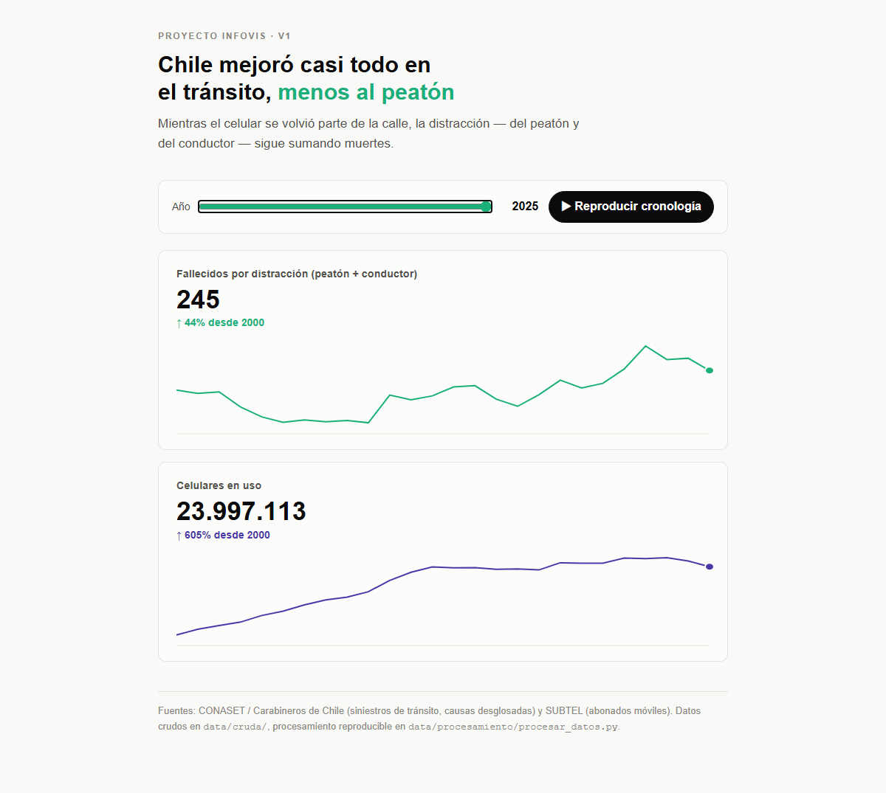
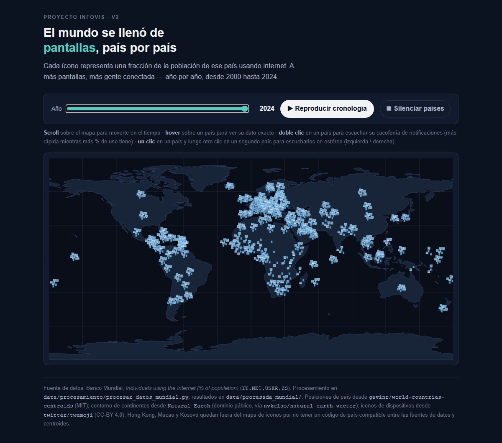
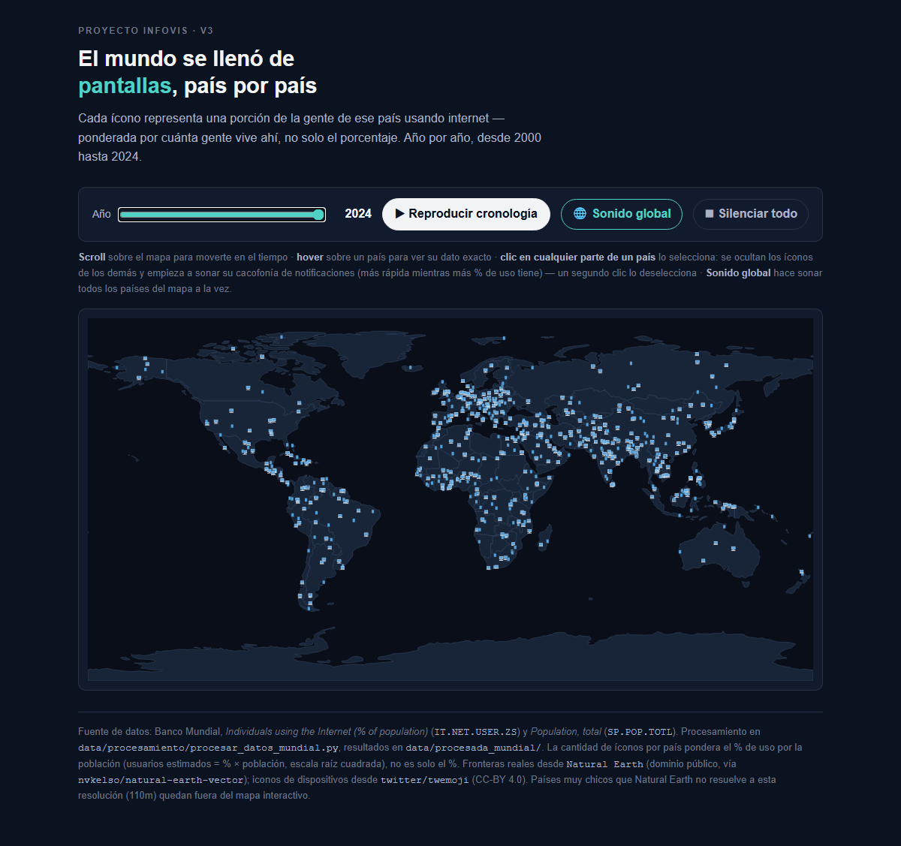
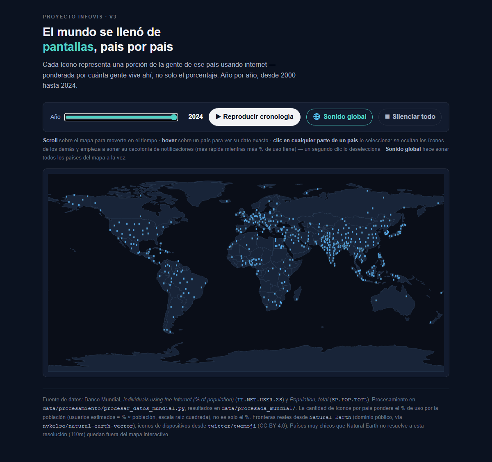

# Entrega 1 — Proyecto de Visualización de Información (IIC2026)

**Grupo 8**

## 1. Portada

**Integrantes:**

- Catalina Isabel Díaz Oyanedel
- Diego Jesús Olivares Pérez
- Joaquín Alonso Toro Parra
- Rocío Antonia Márquez Correa

**Enlaces:**

- GitHub Pages: https://dogo42005.github.io/Proyecto_Infovis/
- Repositorio: https://github.com/dogo42005/Proyecto_Infovis.git
- Video: https://drive.google.com/file/d/1Q2DH3eZ-gNXmtAb_cPlKeQC8f_dEZMzg/view?usp=sharing

---

## 2. Contexto general

### Mensaje principal

La visualización muestra cómo el acceso a internet se expandió por el mundo entre 2000 y 2024: cada país del mapa despliega una cantidad de íconos de celular proporcional a cuánta gente lo usa ahí, ponderando el porcentaje de uso por la población y la densidad del país — no solo el porcentaje crudo. Así, un país grande y conectado pesa más en el mapa que uno chico con el mismo porcentaje de uso, evitando que un solo país extremo (China) defina toda la escala visual. El mapa de 2000 se ve casi vacío; el de 2024, mucho más lleno — el cambio en el tiempo es el mensaje central. La sonificación refuerza esto: seleccionar un país hace sonar una cacofonía de notificaciones cuyo ritmo sigue exactamente la cantidad de íconos de ese país ese año, y un modo "sonido global" hace lo mismo a escala planetaria, siguiendo el porcentaje mundial ponderado por población.

### Origen y procesamiento de los datos

Datos del Banco Mundial: uso de internet (`IT.NET.USER.ZS`), población total (`SP.POP.TOTL`) y densidad poblacional (`EN.POP.DNST`), bajados directo de su API pública. Fronteras reales de países desde Natural Earth (dominio público, resolución 110m). El script `data/procesamiento/procesar_datos_mundial.py` filtra agregados regionales, genera una nube fija de puntos dentro del polígono real de cada país (grilla con jitter, semilla fija), y calcula cuántos de esos puntos se muestran por año según un peso (% × población, ajustado por densidad) normalizado contra el percentil 99.5 de todos los países y años — no el máximo absoluto, para que China/India no definan solas la escala.

---

## 3. V1 — La idea completa

**Identificación**

- Fecha: 24–29 de septiembre de 2026
- Commit: [`de6b037`](https://github.com/dogo42005/Proyecto_Infovis/commit/de6b037) "reescalamiento" (estado final de V1, sobre [`579f08d`](https://github.com/dogo42005/Proyecto_Infovis/commit/579f08d) "V1 entrega")

**Evidencia**

- Captura:

**Qué cambió**
Versión inicial completa: dos gráficos de línea SVG (sin librerías externas) sobre Chile — fallecidos por distracción (peatón + conductor) vs. abonados móviles activos, 2000–2025. Slider de año y botón "Reproducir cronología" sincronizan ambos gráficos. Sonificación con Tone.js: un sonido de choque de auto que se va superponiendo en capas cada 5 segundos reales de reproducción, cada vez más caótico, sin depender de una rampa de volumen.

**Por qué cambió (rationale)**
No hay versión previa, así que el rationale es el de las decisiones iniciales: se eligió un dataset local y verificable (CONASET/Carabineros y SUBTEL) para anclar el mensaje en evidencia real, no en datos genéricos. Se optó por gráficos de línea dibujados a mano en vez de una librería (Plotly) para tener control total sobre la interacción y evitar quedar atados a su comportamiento por defecto — requisito explícito de la pauta (sección 11: "la interacción... va más allá de la que Plotly trae por defecto"). La sonificación en capas superpuestas (no solo volumen) sigue el principio del curso de usar parámetros efectivos de sonido más allá de la intensidad.

**Qué se descartó**
Se descartó mostrar los datos de distracción 2000–2010 con una estimación o relleno artificial de los años sin registro confiable — en su lugar se usó solo el componente del peatón (registrado de forma consistente todo el período) para esos años, documentado como tal en el código. También se descartaron diseños previos de barras crecientes/tiles estadísticos en favor de los gráficos de línea, por mayor claridad de tendencia temporal.

---

## 4. R1 — Revisión con el equipo docente

**Fecha:** 29 de septiembre, 1 y 2 de octubre de 2026 (3 días, diálogo individual con cada integrante)

**Síntesis de lo discutido**
El profesor señaló que la forma de mostrar los gráficos de Chile no dejaba ver una relación entre el uso de celular y la distracción: dos series con escalas distintas, comparadas visualmente, no comunicaban correlación aunque ambas tendencias subieran.

**Decisiones tomadas**
Se adoptó un cambio de enfoque completo: en vez de forzar la comparación visual de dos variables en gráficos separados, mostrar una sola variable (uso de internet en el mundo) en un mapa interactivo, donde el mensaje no depende de que el espectador infiera una correlación. Se descartó intentar "arreglar" el gráfico de dos líneas (por ejemplo, con un scatter plot) manteniendo el dataset de Chile, porque el mensaje original (distracción vial) perdía fuerza al no poder mostrarse con datos confiables para todo el período 2000–2025. Esta decisión se refleja directamente en V2.

---

## 5. V2 — Primera iteración de diseño

**Identificación**

- Fecha: 6 de octubre de 2026
- Commit: [`c55bccd`](https://github.com/dogo42005/Proyecto_Infovis/commit/c55bccd) "mapa_circulos"

**Evidencia**

- Captura:

**Qué cambió**
Pivote completo de dataset y forma visual: mapa mundial (proyección equirectangular dibujada a mano) con un ícono por cada ~10% de población conectada, repartidos en círculo (patrón de semillas de girasol) alrededor del centroide de cada país — mezclando íconos de celular, laptop y computador. Interacción: doble clic en un país inicia su sonificación (centrada); un clic en un segundo país la pasa a estéreo (izquierda/derecha), comparando dos países a la vez. Fuente: Banco Mundial (% de uso de internet).

**Por qué cambió (rationale)**
Directamente anclado en R1: la pauta solo exige que la vista general "transmita un mensaje significativo por sí sola" (Entrega_1.html, sección 1), no una correlación entre dos variables — al mostrar una sola variable (adopción de internet) el problema de "no se ve relación" desaparece de raíz, porque ya no se afirma una relación que el espectador deba inferir. El mapa de puntos se inspiró en el propio visualizador de mapas de datos del Banco Mundial (data.worldbank.org), fuente de los datos usados.

**Qué se descartó**
Se descartó mantener el dataset de Chile (CONASET/SUBTEL) y la comparación de dos series temporales. Se descartó también, en esta etapa, usar fronteras reales de países (centroide + círculo fue la solución más rápida de implementar para la primera iteración del mapa).

---

## 6. R2 — Revisión entre pares

**Fecha:** 8 de octubre de 2026

**Síntesis de lo discutido**
Revisión entre pares supervisada por ayudante: el grupo 8 evaluó al grupo 14 (proyecto sobre disminución de colmenas de abejas) y recibió feedback del grupo 14 sobre V2. El feedback completo del grupo 14 señaló, entre otros puntos: (1) la vista general no se entiende sin interactuar; (2) los íconos representan porcentaje, no cantidad absoluta de personas — ejemplo citado: los puntos concentrados en el centro geográfico de Rusia, donde casi no vive gente, podían leerse erróneamente como el lugar del aumento; (3) el sonido no queda claro al comparar países y se reproduce desacoplado del paso del tiempo; (4) título y controles ocupaban demasiado espacio frente al mapa; (5) conservar el slider de tiempo, que sí aporta sentido.

**Decisiones tomadas**
Se adoptó: distribuir los íconos dentro del polígono real de cada país en vez de un círculo alrededor del centroide (atiende directamente la crítica sobre Rusia); ponderar la cantidad de íconos por población (y más adelante densidad), no solo por el porcentaje crudo; rediseñar la sonificación para que dependa de la interacción con el mapa de forma más clara. Se descartó, por alcance y tiempo, agregar zoom/pan interactivo sobre el mapa (sugerido explícitamente por el grupo 14 en "Cambiar").

---

## 7. V3 — Segunda iteración de diseño

**Identificación**

- Fecha: 12 de octubre de 2026
- Commits: [`4ed8265`](https://github.com/dogo42005/Proyecto_Infovis/commit/4ed8265) "R3", [`13fb4d9`](https://github.com/dogo42005/Proyecto_Infovis/commit/13fb4d9) "R3 sonido global", [`e0585a0`](https://github.com/dogo42005/Proyecto_Infovis/commit/e0585a0) "R3 sound"

**Evidencia**

- Captura:

**Qué cambió**
Cada país pasó a ser su polígono real (fronteras de Natural Earth) en vez de un círculo sobre un centroide — la frontera es a la vez el borde visible y el área clickeable completa, no solo un punto central. Se reemplazó la comparación estéreo entre dos países por una selección única: un clic en cualquier parte de un país lo selecciona, oculta los íconos de los demás y arranca su sonificación; un botón "Sonido global" hace sonar todos los países a la vez como un único flujo (no 169 en paralelo, que saturaba el audio). Primera versión de la ponderación por población para la cantidad de íconos.

**Por qué cambió (rationale)**
Responde directo a la R2: la distribución dentro del polígono real ataca la crítica puntual sobre Rusia; la selección única en vez de comparar dos países simultáneamente simplifica la sonificación para que "quede claro qué sonido representa a cada país" (otra crítica del grupo 14); que toda la superficie del país sea clickeable facilita la interacción sobre países pequeños en el mapa.

**Qué se descartó**
Se descartó la comparación estéreo entre dos países de V2 — el grupo 14 señaló que no quedaba claro qué sonido correspondía a cada uno al compararlos, así que se simplificó a un país a la vez. Se descartó también el layout circular de íconos (reemplazado por distribución real dentro del polígono).

---

## 8. R3 — Revisión con el equipo docente

**Fecha:** 13, 15 y 16 de octubre de 2026 (3 días)

**Síntesis de lo discutido**
El equipo docente reforzó los mismos dos focos que ya había marcado el grupo 14 en R2: el sonido y la forma en que los íconos representan la cantidad de gente conectada por país.

**Decisiones tomadas**
Se adoptó seguir refinando la fórmula de ponderación de íconos (incorporar densidad poblacional como ajuste, y normalizar contra un percentil alto en vez del máximo absoluto, para que un solo país extremo como China no defina toda la escala) y rediseñar el sonido para que: (a) siga siempre la misma cantidad de íconos que se ve en el mapa, no el porcentaje crudo; (b) el "sonido global" sea un único flujo ligado al porcentaje mundial ponderado, no 169 países sonando en paralelo; (c) el sonido se mantenga activo y se actualice durante la reproducción automática de la cronología. Estas decisiones se implementaron en V4.

---

## 9. V4 — La versión final

**Identificación**

- Fecha: 13–22 de octubre de 2026
- Commits: [`8c74c4b`](https://github.com/dogo42005/Proyecto_Infovis/commit/8c74c4b) "R3 final", [`c14c06d`](https://github.com/dogo42005/Proyecto_Infovis/commit/c14c06d) "post R3" → [`c1f26ed`](https://github.com/dogo42005/Proyecto_Infovis/commit/c1f26ed) "E1 final" (22 de octubre, estado actual en producción)

**Evidencia**

- Captura:

- Video: https://drive.google.com/file/d/1Q2DH3eZ-gNXmtAb_cPlKeQC8f_dEZMzg/view?usp=sharing

**Qué cambió**
Fórmula de ponderación final: peso = usuarios estimados (% × población) ajustado por densidad poblacional, normalizado contra el percentil 99.5 (no el máximo absoluto) — en 2024, China e India llegan juntas al tope de íconos, ninguna define sola la escala. El sonido por país y el sonido global ahora siguen siempre la misma cantidad de íconos/porcentaje que se ve en pantalla, con silencio real cuando corresponde. Se unificó a un solo tipo de ícono (celular, no mezcla de dispositivos) y se subió el tope de íconos por país de 36 a 50, repartidos en una grilla con variación aleatoria que cubre todo el territorio del país en vez de sampleo puramente al azar.

**Por qué cambió (rationale)**
Iteración interna del equipo tras R3: al revisar el resultado, se notó que países de tamaño "mediano" (ej. Chile y EEUU) quedaban visualmente casi indistinguibles entre sí porque ambos estaban lejos del máximo histórico (China), aunque la población de EEUU es ~17 veces la de Chile. Se ajustó el exponente de ponderación y el tipo de normalización (percentil en vez de máximo absoluto) hasta lograr que esa diferencia se notara (Chile=2, EEUU=30 íconos en 2024) sin que China/India dejaran de pesar más que el resto. El método de distribución de puntos se cambió a una grilla con jitter porque el sampleo 100% aleatorio podía, por azar, amontonar los íconos en una esquina del país en vez de cubrir su territorio real.

**Qué se descartó**
Se probó ponderar en partes iguales población, densidad y porcentaje (media geométrica de los tres) — se descartó porque diluía demasiado el cambio 2000→2024: población y densidad casi no cambian de un año a otro, así que le restaban protagonismo al porcentaje de uso, que es la variable que sí evoluciona. Se probaron exponentes de ponderación 0.5 (raíz cuadrada) y 0.75 antes de llegar a 1.0 con ajuste de densidad, porque los primeros comprimían demasiado la diferencia entre países medianos.

---

## 10. El feedback al otro grupo (dado en la R2)

**El proyecto evaluado**
Grupo 14: visualización sobre la disminución de colmenas de abejas en Estados Unidos y el efecto de la reposición por parte de apicultores, mostrada como un diagrama de hexágonos coloreados (naranjo oscuro = vivas desde el inicio, naranjo claro = repuestas, blanco = muertas) junto a un gráfico de línea temporal, con sonificación por volumen.

**El feedback que dieron**
El mensaje se entiende gracias a los hexágonos y sus tonos, y el contexto (qué/cuándo/dónde/por qué) está bien resuelto, aunque falta especificar más las causas de muerte de las colmenas y el detalle completo del período cuando este abarca varios meses. El problema más importante señalado fue de escala: el diagrama tiene un tope fijo de 100 hexágonos coloreados, así que en períodos con más de 100 colmenas el excedente no se visualiza (solo aparece el número) — y el total de EEUU no se explicó si corresponde a la suma real de los estados o a una proporción, lo cual debería ser consistente con la escala del resto del diagrama. También se sugirió usar una línea punteada para los períodos sin encuesta, en vez de solo un rectángulo gris, para distinguir datos reales de "fantasma". El sonido sí se consideró un acierto: el volumen decreciente junto con la cantidad de colmenas vivas refuerza el mensaje de forma clara.

**Lo que se llevaron para su propio proyecto**
La crítica al grupo 14 sobre representar siempre en relación al total (no con un tope fijo que "pierde" el excedente) es, en esencia, el mismo problema que el grupo 14 les señaló a ustedes sobre los íconos por país — confirma que la decisión de normalizar contra un percentil en vez de un tope absoluto fue el camino correcto. La observación sobre explicitar el período completo (no solo el inicial) es un recordatorio aplicable al propio slider de año.

---

## 11. Evaluación con usuarios

La validación externa del proyecto vino principalmente de la revisión entre pares (R2, sección 6) y de la iteración interna continua del equipo entre versiones. El grupo 14 — ajeno al desarrollo del proyecto y sin haber visto el mapa antes de esa sesión — exploró la V2 y entregó observaciones concretas y accionables: que la vista general no se entendía sin interactuar, que los íconos representaban porcentaje y no cantidad real de personas (con el ejemplo puntual de Rusia), y que el sonido no quedaba claro al comparar países. Esas observaciones funcionaron como el hallazgo externo que en una sesión de *thinking aloud* formal buscaría una bitácora: señalaron justo los puntos ciegos del equipo, y se tradujeron directamente en los cambios de V3 (distribución real por país, ponderación por población, rediseño del sonido) y V4 (ajuste fino de la fórmula, sonido ligado a la cantidad de íconos).

